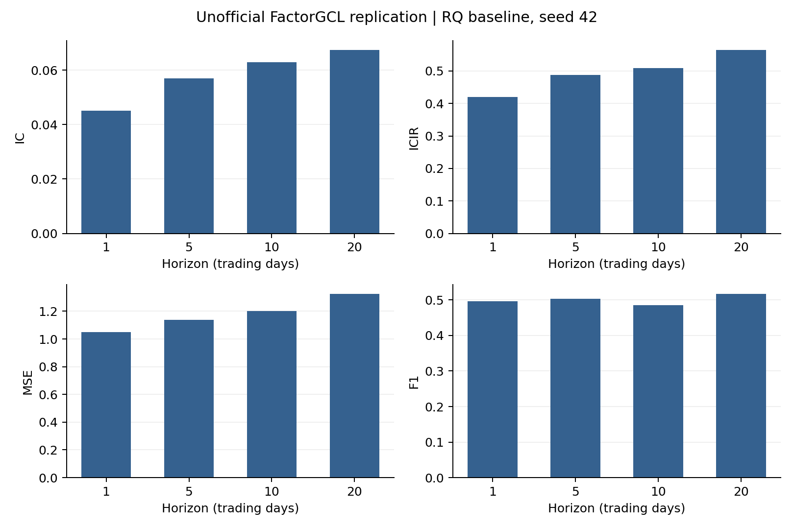

# FactorGCL-Replication

**Unofficial, independent replication — this is NOT the authors' official code.**

[English](README.md) | [简体中文](README.zh-CN.md)

This repository archives **one full FactorGCL baseline experiment using RQData, seed 42**, with two rolling folds. It contains the implementation, a portable configuration, aggregate results, complete epoch-level loss/validation records, fold scalers, and the best model weights. It does not claim to reproduce the paper's numerical results exactly.

## Original paper and attribution

**FactorGCL: A Hypergraph-Based Factor Model with Temporal Residual Contrastive Learning for Stock Returns Prediction**  
**Yitong Duan, Weiran Wang, Jian Li**, Tsinghua University.  
AAAI 2025, *Proceedings of the AAAI Conference on Artificial Intelligence*, **39(1), 173–181**.

- [Official publication](https://ojs.aaai.org/index.php/AAAI/article/view/31993)
- [DOI: 10.1609/aaai.v39i1.31993](https://doi.org/10.1609/aaai.v39i1.31993)
- [arXiv author version](https://arxiv.org/abs/2502.05218)
- Local references: [paper.pdf](paper.pdf), [appendix.pdf](appendix.pdf)

The local paper is the arXiv v1 author version dated 5 February 2025. This project is not affiliated with or endorsed by the authors, Tsinghua University, or AAAI. Research credit belongs to the original authors; repository maintenance and this independent implementation are by [adrianelo0107](https://github.com/adrianelo0107).

## Scope and recorded results

Only the RQ baseline run `rq_variants_20261005/seed_42` is included. The name reflects its original local directory; **this repository contains only that baseline**, with the original reconstructed VWAP, full prior/hidden/alpha modules, temporal contrastive learning, and unclipped return labels. It contains no seed-0 run, ensemble, status-screening experiment, ablation study, alternative VWAP experiment, or investment simulation.

The out-of-sample period is January 2020–June 2023: **846 signal days, 42 months, 3,384 date/horizon combinations**. The original complete prediction export had 14,620,736 stock/date/horizon rows across both folds; these stock-level files are excluded because they contain actual labels and returns.

| Horizon (trading days) | IC | ICIR | MSE | F1 |
|---|---:|---:|---:|---:|
| 1 | 0.045008 | 0.420160 | 1.049365 | 0.497126 |
| 5 | 0.056977 | 0.487863 | 1.137048 | 0.502686 |
| 10 | 0.062938 | 0.508223 | 1.201693 | 0.485725 |
| 20 | 0.067502 | 0.565454 | 1.324709 | 0.516920 |

These are archived results from the completed run, not numbers generated by a synthetic smoke test. Selecting seed 42 for this release is a scope choice; a single seed does not establish robustness.

- **IC:** mean daily cross-sectional Pearson correlation on valid labels.
- **ICIR:** mean daily IC divided by its population standard deviation (`ddof=0`), without annualization.
- **MSE:** equally weighted daily MSE against cross-sectionally standardized labels. Pooled MSE is also retained separately.
- **F1:** pooled sign-classification counts for predictions and standardized labels, using the implementation's strict `>0`/`<0` convention. This is not a classification of positive raw returns. Zero-sign observations are counted separately.

Out-of-sample metrics are recomputed from the concatenated daily observations, rather than averaging the two fold-level ICIR or F1 values. Monthly results are descriptive evaluations of the same test period.



[Complete training/validation history](results/rq_seed42/figures/training_history.png) · [42-month IC](results/rq_seed42/figures/monthly_ic.png)

## Protocol and differences from the paper

| Setting | This replication |
|---|---|
| History / future contrastive window | 60 / 20 trading days |
| Features | high, open, low, close, reconstructed VWAP, volume |
| Model | Full FactorGCL; 2-layer GRU; embedding 32; hidden factors 32; last-state BatchNorm |
| Prior factors | **134 static SW2021 level-2 industries**, instead of the paper's 83 industries |
| Loss | Masked MSE + `0.1 ×` temporal contrastive loss; temperature 0.1 |
| Optimizer | Adam, learning rate 0.001, no weight decay |
| Initialization | Seed **42** for each fold; the paper reports seed 0 |
| Batching | One complete date cross-section per optimizer step; dates shuffled |
| Feature clipping | Training-only 0.1% / 99.9% quantiles; seeded priority reservoir, 200,000 samples per feature |
| Missing observations | At most 20% missing in a 60-day history; normalized/clipped inputs filled with zero; invalid labels masked |
| Boundary protection | 21-trading-day lookahead purge at the ends of training and validation partitions |
| Early stopping | Maximum 100 epochs; validate once per epoch; strictly improve mean 1/5/10/20-day validation IC; stop after 20 consecutive non-improvements; `min_delta=0`; test the best checkpoint |

The appendix explicitly states **“100 epochs, with early stopping set to 20 steps”**. Its monitoring metric and the exact meaning of “steps” are not specified. Epoch-based checks, mean four-horizon validation IC, and `min_delta=0` are disclosed implementation choices, as are encoder/BatchNorm details, clipping/missingness thresholds, and the rolling stride.

| Fold | Training | Validation | Test | Best epoch | Stop epoch | Best validation mean IC |
|---|---|---|---|---:|---:|---:|
| 1 | 2014–2018 | 2019 | 2020–2021 | 28 | 48 | 0.084643812 |
| 2 | 2016–2020 | 2021 | Jan 2022–Jun 2023 | 22 | 42 | 0.049591568 |

Calendar ranges above precede the boundary purge. Each fold starts from scratch and fits its own scaler; neither model weights nor scalers are reused from another experiment. The forecast label is `VWAP[t+h+1] / VWAP[t+1] − 1`, followed by cross-sectional standardization over valid stocks (`ddof=0`). Returns and standardized labels are not clipped.

**VWAP and data limitations.** Adjusted OHLC and volume come from the RQ snapshot. VWAP was reconstructed using a same-stock/same-date multiplier estimated from the four adjusted versus unadjusted OHLC prices, constrained to their common four-decimal rounding intervals (half-unit `0.00005`). The formula is `estimated_factor × (new_turnover / old_unadjusted_volume)`. New and old turnover must match, and the new RQ volume is retained as the volume feature. This is an estimated reconstruction, not a provider-supplied adjustment factor; it is used for both features and return labels. VWAP is not clamped to daily high/low. The portable utility rejects material range violations using the historical `0.011` tolerance.

This baseline does **not** apply the later ST/suspension/status screens. Endpoint labels use available positive prices; there is no holding-path tradability screen. The pre-adjusted snapshot's base date is unknown, and the static industry assignments contain later classification information. Consequently, this is not a complete point-in-time or investable backtest. RQ data, sample construction, 134 industries, and unspecified implementation details prevent a like-for-like numerical comparison with the original paper.

## Files

```text
paper.pdf / appendix.pdf          Original reference documents
README.md / README.zh-CN.md      English / Chinese documentation
CITATION.cff / NOTICE / LICENSE  Citation, attribution and licensing scope
requirements.txt                Original-run dependency pins
code/configs/rq_seed42.json      Portable seed-42 configuration
code/factorgcl/                  Executed core implementation
code/train.py                   Seed-42-only training/cache entry point
code/reconstruct_vwap.py         Portable VWAP reconstruction utility
code/verify_results.py           Data-free archive/metric verification
code/plot_results.py             Plot archived aggregate results
code/smoke_test.py               Synthetic CPU forward/backward/resume check
results/rq_seed42/               Published aggregate metrics and model artifacts
SHA256SUMS.json                  Checksums of the distributed files
```

`results/rq_seed42/` includes fold/test and combined daily metrics, 42-month metrics, full epoch logs, all epoch validation summaries, best/last validation statistics, scalers, plots, a small environment record, and provenance. Each `model_state.pt` contains **model tensors only**, extracted from that fold's original best checkpoint; load with `torch.load(..., weights_only=True)`. These files contain no optimizer/RNG state and cannot resume the historical training run. Model input preprocessing still requires the corresponding scaler and compatible industry ordering.

The shared numerical engine, data, evaluation and model files were checked against the executed snapshot's SHA-256 manifest and copied unchanged. The training-plot function was extracted from a larger reporting module; paths and explanatory notes were made portable; the seed-42-only launcher retains the historical signature scheme and validation logging. Details and original input fingerprints are recorded in [provenance.json](results/rq_seed42/provenance.json). That file is not a claim that omitted raw data or predictions were independently reverified by a fresh clone.

## Install and verify without data

Original recorded environment: Python 3.11.5, PyTorch 2.2.2+cu121, NumPy 1.26.4, pandas 2.2.3, NVIDIA RTX 4090, CUDA 12.1. For the pinned dependencies, use **Python 3.10 or 3.11**. This is a recorded environment subset, not a full environment lock; other hardware or libraries may change numerical results.

Run from the repository root:

```bash
python -m venv .venv
python -m pip install -r requirements.txt
python -B code/verify_results.py
python -B code/smoke_test.py
python -B code/plot_results.py --output-dir outputs/figures
```

Activate the virtual environment using your operating system's normal command before installing. For CUDA, first install the matching official PyTorch wheel, for example `python -m pip install torch==2.2.2 --index-url https://download.pytorch.org/whl/cu121`. Local packaging checks used Python 3.13.5 / PyTorch 2.10.0+cpu; they do not certify cross-version GPU equivalence. The verifier uses only bundled aggregate results; the smoke test creates temporary synthetic data and does not reproduce the financial experiment.

## Supply private inputs and retrain

**No data are distributed**, including market panels, trading calendars, industry assignments/dictionaries, caches, and stock-level predictions with actual labels/returns. Obtain any required data under your provider's authorization. The repository does not download RQData, contain API credentials, or grant a market-data license.

Place your compatible, privately prepared inputs in ignored `data/`:

| File | Required columns / convention |
|---|---|
| `panel.csv` | `order_book_id,date,high,open,low,close,vwap,volume`; unique stock/date; sorted by stock then date; finite positive features; identifiers such as `600000.XSHG` / `000001.XSHE` |
| `trading_calendar.csv` | `date,is_sample_period`; unique ascending market dates, including warmup and label tail; ISO dates and Boolean sample flags |
| `stock_industry_sw2021.csv` | `stock_code,sw2021_l2_id`; six-character codes preserved as strings; one static assignment per stock |
| `sw2021_l2_mapping.csv` | `sw2021_l2_id`; complete IDs `0..133` |

The archived inputs span 2013-10-10–2023-07-31, preserving the 59-day warmup and 21-day label tail around the formal 2014-01-01–2023-06-30 signal period. Its prepared panel has 8,207,297 rows; the industry-matched cache has 8,134,074 observed rows and shape `2390 × 4898 × 6` (4,897 stocks with at least one observation). These counts identify the historical snapshot; a newly downloaded snapshot may differ. Private-file SHA-256 values are included for comparison without publishing their contents.

The training loader consumes this prepared schema, not an arbitrary raw-provider file. The optional VWAP utility requires already cleaned, same-key adjusted and unadjusted CSVs containing OHLC, `volume`, and `total_turnover`:

```bash
python -B code/reconstruct_vwap.py --adjusted data/adjusted_clean.csv --unadjusted data/unadjusted_clean.csv --output data/panel.csv
python -B code/train.py --prepare-only
python -B code/train.py
python -B code/train.py --fold fold_1 --resume
```

Both folds run serially in a new `outputs/rq_seed42/`; the released `results/` archive is protected from training overwrite. Use `--device cpu` for a CPU run or `--device auto` for automatic selection. Resume requires the new run's own `last.pt` with optimizer, scaler and RNG state; published tensor-only weights are not substitutes. Cache signatures include input-file metadata, so moved/regenerated inputs may need a newly built cache; identical historical signatures or bitwise GPU results are not guaranteed.

## Citation and license

Please cite the original paper when using the method and acknowledge this repository when using its implementation. Machine-readable attribution is in [CITATION.cff](CITATION.cff).

```bibtex
@article{duan2025factorgcl,
  title={FactorGCL: A Hypergraph-Based Factor Model with Temporal Residual Contrastive Learning for Stock Returns Prediction},
  author={Duan, Yitong and Wang, Weiran and Li, Jian},
  journal={Proceedings of the AAAI Conference on Artificial Intelligence},
  volume={39}, number={1}, pages={173--181}, year={2025},
  doi={10.1609/aaai.v39i1.31993},
  url={https://ojs.aaai.org/index.php/AAAI/article/view/31993}
}
```

The independent replication software and repository documentation are MIT licensed. **The original paper and appendix retain their original authors'/publisher's rights and are excluded from that license.** No rights to third-party market or industry data are granted. See [LICENSE](LICENSE) and [NOTICE](NOTICE).
