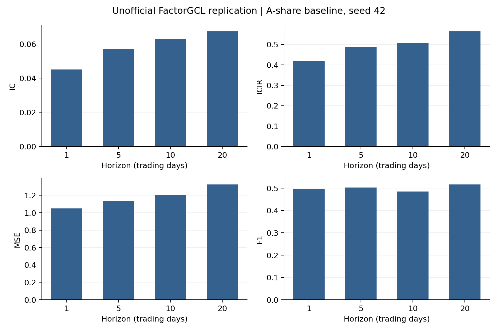

# FactorGCL-Replication

**非官方、独立复现：本仓库不是论文作者发布的官方代码。**

[English](README.md) | [简体中文](README.zh-CN.md)

本仓库仅整理**使用A股日频数据（前复权）、seed=42的完整FactorGCL基线实验**，含两折滚动训练的代码、可移植配置、汇总结果、完整逐轮loss/验证记录、各折scaler和最佳模型权重。不宣称精确重现了论文中的数值结果。

## 原论文与署名

**FactorGCL: A Hypergraph-Based Factor Model with Temporal Residual Contrastive Learning for Stock Returns Prediction**  
作者：**Yitong Duan、Weiran Wang、Jian Li**，清华大学。  
AAAI 2025，*Proceedings of the AAAI Conference on Artificial Intelligence*，**39(1)，173–181**。

- [论文官方网站](https://ojs.aaai.org/index.php/AAAI/article/view/31993)
- [DOI：10.1609/aaai.v39i1.31993](https://doi.org/10.1609/aaai.v39i1.31993)
- [arXiv作者版本](https://arxiv.org/abs/2502.05218)
- 本地参考：[原论文](paper.pdf)、[附录](appendix.pdf)

仓库内原论文为2025年2月5日的arXiv v1作者版本。本项目与论文作者、清华大学及AAAI不存在隶属或背书关系。研究方法归功于原论文作者；本独立实现及仓库由[adrianelo0107](https://github.com/adrianelo0107)维护。

## 上传范围与实际结果

归档实验标识为`ashare_seed42_20261005`；**本仓库仅包含seed42基线实验**，保留当次重建VWAP、完整prior/hidden/alpha模块、时间对比学习及未裁剪收益标签。不包含seed0、ensemble、状态筛选、消融、其他VWAP实验或投资模拟。

样本外区间为2020年1月至2023年6月，共**846个信号日、42个月、3,384个日期/期限键**。原两折全图预测合计14,620,736个股票/日期/期限行；因逐股票文件包含真实收益和标签，未上传这些文件。

| 预测期限（交易日） | IC | ICIR | MSE | F1 |
|---|---:|---:|---:|---:|
| 1 | 0.045008 | 0.420160 | 1.049365 | 0.497126 |
| 5 | 0.056977 | 0.487863 | 1.137048 | 0.502686 |
| 10 | 0.062938 | 0.508223 | 1.201693 | 0.485725 |
| 20 | 0.067502 | 0.565454 | 1.324709 | 0.516920 |

以上来自已完成的正式实验，非合成烟测结果。本次仅发布seed42是仓库范围选择，单种子结果不能证明稳健性。

- **IC**：有效标签截面上逐日Pearson相关系数的时间均值。
- **ICIR**：日IC均值除以总体标准差（`ddof=0`），不年化。
- **MSE**：对有效截面标准化标签计算每日MSE，再对日期等权平均；另保留pooled MSE。
- **F1**：对预测与截面标准化标签的正负号汇总TP/FP/FN，采用实现中的严格`>0`/`<0`规则；不是对原始收益是否大于零分类。零符号观察另计。

总样本外指标由两折日度记录拼接后重新计算，不直接平均两折ICIR或F1。月度结果仅为同一测试区间的事后描述。



[完整训练与验证曲线](results/ashare_seed42/figures/training_history.png) · [42个月IC](results/ashare_seed42/figures/monthly_ic.png)

## 实验协议与论文差异

| 项目 | 本次实现 |
|---|---|
| 历史/未来对比窗口 | 60/20个交易日 |
| 输入 | high、open、low、close、重建VWAP、volume |
| 模型 | 完整FactorGCL；2层GRU；嵌入32维；32个隐藏因子；末态BatchNorm |
| 先验行业 | **静态SW2021二级行业134类**；论文为83类 |
| 损失 | masked MSE + `0.1 ×`时间对比损失；温度0.1 |
| 优化器 | Adam，学习率0.001，weight decay为0 |
| 随机初始化 | 每折均从seed **42**开始；论文报告seed0 |
| 训练步 | 一日完整股票截面；训练日期洗牌 |
| 特征裁剪 | 仅训练段拟合0.1%/99.9%分位点，每特征最多200,000个seed控制的priority-reservoir样本 |
| 缺失处理 | 60日历史最多20%缺失；输入归一化/裁剪后填0；无效标签mask |
| 分区边界 | 训练和验证尾部剔除21个交易日的前视跨度 |
| 早停 | 最多100轮；每轮验证一次；四期限验证IC均值严格提高才更新best；连续20轮未改善即停；`min_delta=0`；用best测试 |

附录明确给出**“100 epochs, with early stopping set to 20 steps”**，未明确监控指标及steps的精确定义。本项目每epoch检查、四期限验证IC均值及`min_delta=0`属于复现的具体实现选择；编码器/BN细节、裁剪/缺失阈值和滚动步长也均有实现假设。

| 折 | 训练区间 | 验证区间 | 测试区间 | best轮 | 停止轮 | 最佳四期限验证平均IC |
|---|---|---|---|---:|---:|---:|
| 1 | 2014–2018 | 2019 | 2020–2021 | 28 | 48 | 0.084643812 |
| 2 | 2016–2020 | 2021 | 2022年1月–2023年6月 | 22 | 42 | 0.049591568 |

表内日期区间为边界purge前的日历范围。每折从头训练、单独拟合scaler，不复用其他实验的模型或scaler。原始收益为`VWAP[t+h+1] / VWAP[t+1] − 1`，再在当日有效股票截面上标准化（`ddof=0`）；不裁剪原始收益或标准化标签。

**数据与预处理。** 使用A股日频数据（前复权）。输入覆盖2013-10-10至2023-07-31，正式信号区间2014-01-01至2023-06-30，测试区间2020-01-01至2023-06-30。保留原OHLC和成交量，利用同股同日四个调整前后OHLC估计共同乘数，约束在四位小数的共同舍入区间内（半单位`0.00005`），然后计算`估计乘数 × 新成交额 / 旧未复权成交量`。要求新旧成交额匹配，原成交量仍作为量特征保留。该值是估计重建值，不是供应商提供的精确复权因子；同时用于特征和收益标签，不将VWAP夹到高低价内。独立工具沿用历史`0.011`容差，对显著越界报错。

**复现边界。** 本基线未应用后来增加的ST、停复牌或交易状态筛选；标签依据端点价格有效性，没有持有路径可交易性筛选。前复权快照基准日未知，静态行业包含较晚分类信息，因此不能视为完整时点可得或可投资回测。样本构造、134行业及论文未披露细节都限制了与原论文的直接数值比较。

## 仓库内容

```text
paper.pdf / appendix.pdf          原论文与补充材料
README.md / README.zh-CN.md      中英说明
CITATION.cff / NOTICE / LICENSE  引用、署名及许可范围
requirements.txt                原运行依赖版本
code/configs/ashare_seed42.json      可移植的seed42配置
code/factorgcl/                  原执行版本的核心实现
code/train.py                   seed42训练/建缓存入口
code/reconstruct_vwap.py         独立VWAP重建工具
code/verify_results.py           无需行情的归档与指标核验
code/plot_results.py             基于已归档汇总结果作图
code/smoke_test.py               合成数据CPU训练/恢复检查
results/ashare_seed42/               实际结果与模型产物
SHA256SUMS.json                  发布文件校验清单
```

结果包括分折及总日度指标、42月指标、完整逐轮训练及验证记录、最后轮验证统计、scaler、图、精简环境记录与来源。`model_state.pt`从各折原best中提取，**仅含模型tensor**，可用`torch.load(..., weights_only=True)`加载；不含优化器、RNG或完整checkpoint配置，不能代替`last.pt`恢复历史训练。使用模型仍需对应scaler和一致的行业列顺序。

核心训练、数据、评估、模型源码均对照原执行版本SHA-256核对，并逐字节保留。训练图函数从原综合reporting模块提取；配置路径及说明作可移植调整；独立入口仅保留seed42及验证记录。公开路径、协议标识和独立训练的checkpoint命名空间使用统一名称；保存的原实验签名仍用于标识历史运行。详见[provenance.json](results/ashare_seed42/provenance.json)，其中也保存未公开输入的指纹；新克隆仅凭这些指纹不能重新验证未提供的原始行情或预测。

## 安装与无数据核验

原环境记录：Python 3.11.5、PyTorch 2.2.2+cu121、NumPy 1.26.4、pandas 2.2.3、RTX 4090、CUDA 12.1。安装锁定依赖请使用**Python 3.10或3.11**。这只是原环境的部分版本记录，不是完整环境锁；不同硬件和库版本可能改变数值结果。

在仓库根目录执行：

```bash
python -m venv .venv
python -m pip install -r requirements.txt
python -B code/verify_results.py
python -B code/smoke_test.py
python -B code/plot_results.py --output-dir outputs/figures
```

安装前按操作系统激活虚拟环境。CUDA环境可先安装官方对应wheel，例如`python -m pip install torch==2.2.2 --index-url https://download.pytorch.org/whl/cu121`。本次本机打包检查使用Python 3.13.5 / PyTorch 2.10.0+cpu，不代表跨版本GPU数值等价。核验脚本只读取本仓库结果；烟测使用临时合成数据验证工程流程，不代表重新完成金融实验。

## 自备输入并重新训练

**不提供数据**，包括行情、交易日历、股票行业表/字典、缓存和含实际标签/收益的逐股票预测。不附带数据文件或凭据，请自行准备下列格式的输入。

私有输入放在被Git忽略的`data/`：

| 文件 | 必需字段及约定 |
|---|---|
| `panel.csv` | `order_book_id,date,high,open,low,close,vwap,volume`；股票/日期唯一并排序；六特征有限且为正；代码如`600000.XSHG`、`000001.XSHE` |
| `trading_calendar.csv` | `date,is_sample_period`；递增且无重复的市场日历，含热身及标签尾部；日期为ISO格式，样本标记为布尔值 |
| `stock_industry_sw2021.csv` | `stock_code,sw2021_l2_id`；六位股票代码按字符串保留；每股一条静态行业记录 |
| `sw2021_l2_mapping.csv` | `sw2021_l2_id`；完整`0..133`映射 |

历史输入覆盖2013-10-10至2023-07-31，在正式2014-01-01至2023-06-30信号区间前后保留59日热身和21日尾部。整理后主表8,207,297行，行业匹配缓存8,134,074个观测、形状`2390 × 4898 × 6`，其中4,897只股票至少出现一次。这些数量用于识别当次数据快照，新下载数据未必相同；输入SHA-256只公布指纹，不公布文件内容。

训练器消费已整理的上述格式，不直接读取任意供应商原始文件。可选VWAP工具要求已清理且同键的调整前后CSV，两者含OHLC、`volume`及`total_turnover`：

```bash
python -B code/reconstruct_vwap.py --adjusted data/adjusted_clean.csv --unadjusted data/unadjusted_clean.csv --output data/panel.csv
python -B code/train.py --prepare-only
python -B code/train.py
python -B code/train.py --fold fold_1 --resume
```

两折串行输出到新的`outputs/ashare_seed42/`；训练入口禁止覆盖发布的`results/`。CPU运行可加`--device cpu`，自动选择可加`--device auto`。恢复需使用该次新运行自己保存、含优化器/scaler/RNG的`last.pt`。缓存签名含输入文件元数据，移动或重新生成输入后可能需另建缓存；不保证复现出历史签名或跨环境逐bit相同的GPU结果。

## 引用与许可

使用方法时请引用原论文，使用代码时也请注明本仓库；机器可读引用见[CITATION.cff](CITATION.cff)。

```bibtex
@article{duan2025factorgcl,
  title={FactorGCL: A Hypergraph-Based Factor Model with Temporal Residual Contrastive Learning for Stock Returns Prediction},
  author={Duan, Yitong and Wang, Weiran and Li, Jian},
  journal={Proceedings of the AAAI Conference on Artificial Intelligence},
  volume={39}, number={1}, pages={173--181}, year={2025},
  doi={10.1609/aaai.v39i1.31993},
  url={https://ojs.aaai.org/index.php/AAAI/article/view/31993}
}
```

独立实现的软件和仓库说明采用MIT许可。**原论文与附录保留作者/出版方原有权利，不适用本仓库MIT许可**，也不授予第三方市场或行业数据使用权。详见[LICENSE](LICENSE)及[NOTICE](NOTICE)。
